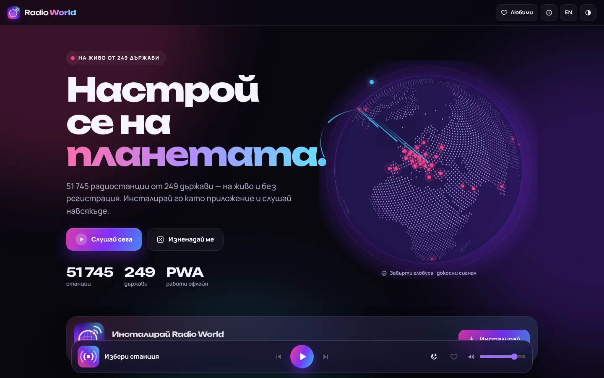

<h1 align="center">Radio World</h1>

<b>Tune in to the planet.</b> 51,000+ live radio stations from 249 countries, in one installable app, in 15 languages.

- **The app** is in [`docs/`](docs/), with its description and how to run it in [`docs/README.md`](docs/README.md).
- **Build scripts** are in [`tools/pwa/`](tools/pwa/).

## License
© 2026 Radio World. **All rights reserved.** See [`LICENSE`](LICENSE).
Third-party components (hls.js, the Unbounded and Manrope fonts, Natural Earth/world-atlas, flags, radio-browser.info data) keep their own licenses. They are listed in [`THIRD_PARTY_NOTICES.md`](THIRD_PARTY_NOTICES.md).
